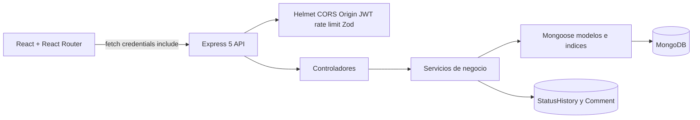

# Arquitectura y permisos

## Arquitectura

Las rutas solo conectan middlewares y controladores. Los controladores traducen HTTP y validan el cuerpo; los servicios deciden permisos, visibilidad, transiciones y agregaciones; los modelos definen enums, referencias e índices.

## Referencias y consistencia

`Ticket` referencia `User` en `creator` y `assignedAgent`. `Comment` y `StatusHistory` son colecciones separadas con referencia a `Ticket` y `User`. Se eligieron referencias porque comentarios e historial crecen sin límite conocido y se consultan como auditoría independiente. La creación y el cambio de estado usan una transacción MongoDB para que ticket e historial se confirmen o fallen juntos.

## Matriz de permisos

| Operación | cliente | agente | admin |
|---|---:|---:|---:|
| Registrarse/iniciar sesión | sí | mediante admin/seed | mediante seed/admin |
| Crear ticket | sí | no | sí |
| Listar tickets | propios | asignados y no asignados | todos |
| Ver notas internas | no | sí, en tickets visibles | sí |
| Comentar | tickets visibles | tickets visibles | tickets visibles |
| Autoasignar | no | sí, si no asignado | no aplica |
| Asignar agente | no | no | sí |
| Cambiar estados de trabajo | no | `abierto -> en_progreso -> resuelto` | mismas transiciones |
| Cerrar ticket resuelto | sí, solo creador | no | no |
| Reabrir ticket resuelto | sí, solo creador | sí, visible | sí |
| Métricas | no | sí | sí |
| Gestionar usuarios | no | no | sí |

El cliente puede cerrar o reabrir desde `resuelto`; el servidor valida siempre el estado actual y el rol.

## Métricas

- Tiempo medio: promedio de `resolvedAt - createdAt` únicamente para tickets que ya tienen `resolvedAt`.
- Carga: tickets asignados que no están `cerrado`, agrupados por agente.
- Estados y prioridades: conteos mediante `$facet` y `$group`.
